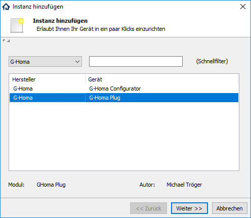
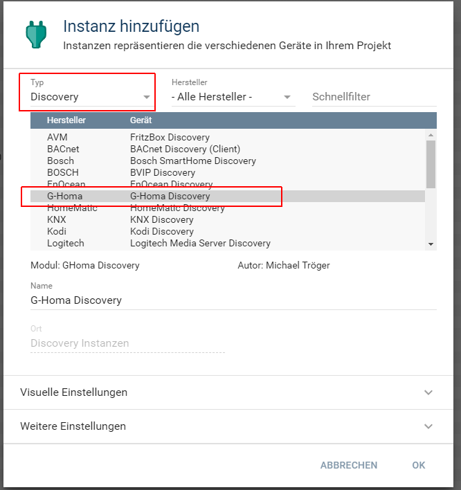
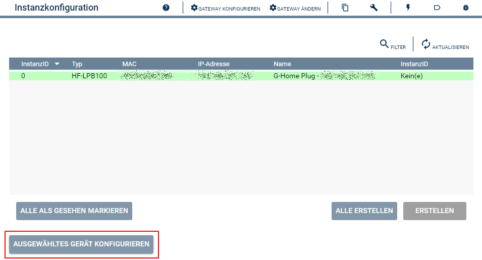
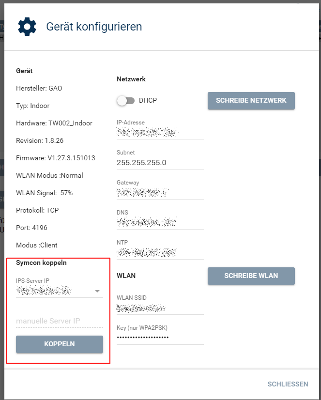

  

   

  

# G-Homa Discovery  <!-- omit in toc -->

Vereinfacht das Anlegen von `G-Homa Steckdose`-Instanzen in Symcon.  
Und kann zum konfigurieren von den Geräten genutzt werden.  

## Inhaltsverzeichnis  <!-- omit in toc -->

- [1. Funktionsumfang](#1-funktionsumfang)
- [2. Voraussetzungen](#2-voraussetzungen)
- [3. Software-Installation](#3-software-installation)
- [4. Einrichten der Instanzen in IP-Symcon](#4-einrichten-der-instanzen-in-ip-symcon)
  - [Geräte im Netzwerk auffinden](#geräte-im-netzwerk-auffinden)
  - [Geräte für Symcon konfigurieren](#geräte-für-symcon-konfigurieren)
- [5. Statusvariablen](#5-statusvariablen)
- [6. Visualisierung](#6-visualisierung)
- [7. PHP-Befehlsreferenz](#7-php-befehlsreferenz)
- [8. Aktionen](#8-aktionen)
- [9. Anhang](#9-anhang)
  - [1. Changelog](#1-changelog)
  - [2. Spenden](#2-spenden)
- [10. Lizenz](#10-lizenz)

## 1. Funktionsumfang

- Auslesen und darstellen aller im Netzwerk gefundenen G-Homa WLAN-Steckdosen.  
- Einfaches Anlegen von neuen Instanzen in Symcon.  
- Auslesen und anpassen der Konfiguration in den Geräten.  

## 2. Voraussetzungen

- Symcon ab Version 8.1  
- G-Homa WLAN-Steckdosen  

## 3. Software-Installation

Dieses Modul ist Bestandteil der [GHoma-Library](../README.md#3-software-installation).  

## 4. Einrichten der Instanzen in IP-Symcon

Das Modul ist im Dialog 'Instanz hinzufügen' unter dem Hersteller 'G-Homa' zufinden.  
  

Alternativ ist es auch in der Liste alle Discovery-Instanzen aufgeführt.  
  

### Geräte im Netzwerk auffinden  

Beim öffnen des Discovery wird folgender Dialog angezeigt.  
  

### Geräte für Symcon konfigurieren  

Über das selektieren eines Eintrages in der Tabelle und anschließenden betätigen des Button `Ausgewähltes Gerät konfigurieren`, können verschiedene Einstellungen im Gerät geändert werden.  
  
Bevor ein Gerät in Symcon benutzt werden kann, muss es einmalig passend umkonfiguriert werden.  
Dies wird durch Auswahl oder Eingabe der Symcon IP-Adresse unter `Symcon koppeln` und mit betätigen des Button `koppeln`, durchgeführt.  

## 5. Statusvariablen

Die Discovery Instanz erstellt kein Statusvariablen.  

## 6. Visualisierung

Die Discovery Instanz besitzt keine darstellbaren Elemente.  

## 7. PHP-Befehlsreferenz

Die Discovery Instanz besitzt keine Instanz-Funktionen.  

## 8. Aktionen

Es gibt keine speziellen Aktionen für dieses Modul.  

## 9. Anhang

### 1. Changelog

[Changelog der Library](../README.md#1-changelog)

### 2. Spenden

  Die Library ist für die nicht kommerzielle Nutzung kostenlos, Schenkungen als Unterstützung für den Autor werden hier akzeptiert:  

  

  

## 10. Lizenz

IPS-Modul:  
[CC BY-NC-SA 4.0](https://creativecommons.org/licenses/by-nc-sa/4.0/)  
