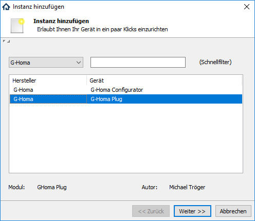
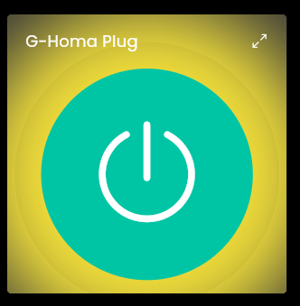
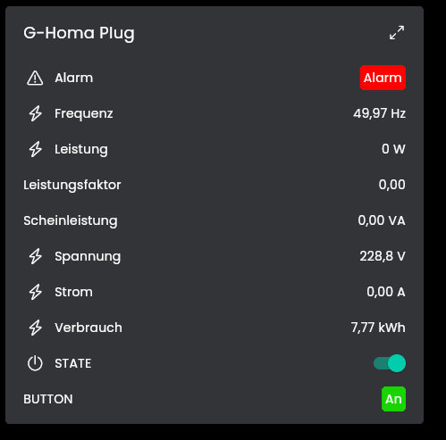
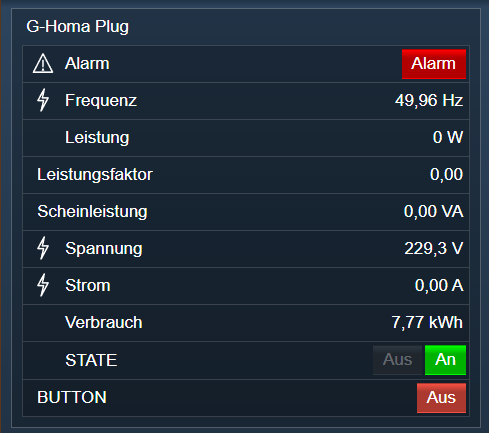

[](https://www.symcon.de/service/dokumentation/entwicklerbereich/sdk-tools/sdk-php/)
[](https://community.symcon.de/t/modul-g-homa-wlan-steckdosen/45924)
[](https://www.symcon.de/de/service/dokumentation/installation/migrationen/v80-v81-q3-2025/)  
[](https://creativecommons.org/licenses/by-nc-sa/4.0/)
[](https://github.com/Nall-chan/GHoma/actions) [](https://github.com/Nall-chan/GHoma/actions)  
[](#2-spenden)
[](#2-spenden)  

# G-Homa Plug  <!-- omit in toc -->

Einbindung einer WLAN-Steckdose von der Firma 'G-Homa'.  

## Inhaltsverzeichnis  <!-- omit in toc -->

- [1. Funktionsumfang](#1-funktionsumfang)
- [2. Voraussetzungen](#2-voraussetzungen)
- [3. Software-Installation](#3-software-installation)
- [4. Einrichten der Instanzen in IP-Symcon](#4-einrichten-der-instanzen-in-ip-symcon)
- [5. Statusvariablen](#5-statusvariablen)
- [6. Visualisierung](#6-visualisierung)
  - [Kachel-Visualisierung](#kachel-visualisierung)
  - [WebFront](#webfront)
- [7. PHP-Befehlsreferenz](#7-php-befehlsreferenz)
- [8. Aktionen](#8-aktionen)
- [9. Anhang](#9-anhang)
  - [1. Changelog](#1-changelog)
  - [2. Spenden](#2-spenden)
- [10. Lizenz](#10-lizenz)

## 1. Funktionsumfang

- Empfangen und darstellen des aktuellen Schaltzustandes, sowie der Energiemessung in Symcon.  
- Steuern des Gerätes aus Symcon.  

## 2. Voraussetzungen

- Symcon ab Version 8.1  
- G-Homa WLAN-Steckdosen  

## 3. Software-Installation

Dieses Modul ist Bestandteil der [GHoma-Library](../README.md#3-software-installation).  

**Hinweis:**
Eine eventuell vorhandene Firewall auf dem Host-System des Symcon-Servers muss so konfiguriert werden, dass der Port 4196 TCP ankommend freigegeben ist.  

## 4. Einrichten der Instanzen in IP-Symcon

Das Anlegen von neuen Instanzen kann komfortabel über die [G-Homa Discovery-Instanz](../GHDiscovery/README.md#4-einrichten-der-instanzen-in-ip-symcon) erfolgen.  

Alternativ ist das Modul im Dialog `Instanz hinzufügen` unter dem Hersteller `G-Homa` zu finden.  
  

Es wird automatisch eine 'Server-Socket' Instanz erzeugt, wenn nicht schon eine passende vorhanden ist.  
In dem sich öffnenden Konfigurationsformular muss die IP-Adresse des Gerätes eingetragen und übernommen werden.  

### Konfigurationsseite <!-- omit in toc -->

| Eigenschaft |  Typ   | Standardwert |          Funktion          |
| :---------: | :----: | :----------: | :------------------------: |
|    Host     | string |              | Die IP-Adresse des Gerätes |

## 5. Statusvariablen

Folgende Statusvariablen werden automatisch angelegt.  

|      Name       |  Typ  |    Ident    | Beschreibung                                                                          |
| :-------------: | :---: | :---------: | :------------------------------------------------------------------------------------ |
|     Status      | bool  |    STATE    | True wenn das Gerät eingeschaltet ist                                                 |
|     Button      | bool  |   BUTTON    | Wird jedes mal auf True gesetzt, wenn das Gerät über die Gerätetaste betätigt wurde.       |
|      Alarm      | bool  |    ALARM    | Wird auf True aktualisiert, wenn die Gerätetaste länger als 5 Sekunden gedrückt wird. |
|    Leistung     | float |    Power    | Leistung in Watt                                                                      |
|    Verbrauch    | float | Consumption | Verbrauch in kWh                                                                      |
|    Spannung     | float |   Voltage   | Spannung in Volt                                                                      |
|      Strom      | float |   Current   | Strom in Ampere                                                                       |
|    Frequenz     | float |  Frequenz   | Frequenz in Hertz                                                                     |
| Scheinleistung  | float |   Output    | Scheinleistung in VA                                                                  |
| Leistungsfaktor | float | PowerFactor | Leistungsfaktor                                                                       |

## 6. Visualisierung

### Kachel-Visualisierung  

**Einzelnes Element:**  
  

**Listendarstellung:**  
  

### WebFront

  

## 7. PHP-Befehlsreferenz

```php
bool GHOMA_SendSwitch(int $InstanzID, bool $Value)
```

Schaltet das Gerät bei `true` ein und bei `false` aus.  
Hat das Gerät den Befehl erfolgreich ausgeführt, wird `true` zurück gegeben.  
Im Fehlerfall wird eine Warnung erzeugt und `false`zurück gegeben.  

## 8. Aktionen

Es gibt keine speziellen Aktionen für dieses Modul.  

## 9. Anhang

### 1. Changelog

[Changelog der Library](../README.md#1-changelog)

### 2. Spenden

  Die Library ist für die nicht kommerzielle Nutzung kostenlos, Schenkungen als Unterstützung für den Autor werden hier akzeptiert:  

[](https://paypal.me/Nall4chan)  

[](https://www.amazon.de/hz/wishlist/ls/YU4AI9AQT9F?ref_=wl_share)  

## 10. Lizenz

IPS-Modul:  
[CC BY-NC-SA 4.0](https://creativecommons.org/licenses/by-nc-sa/4.0/)  
